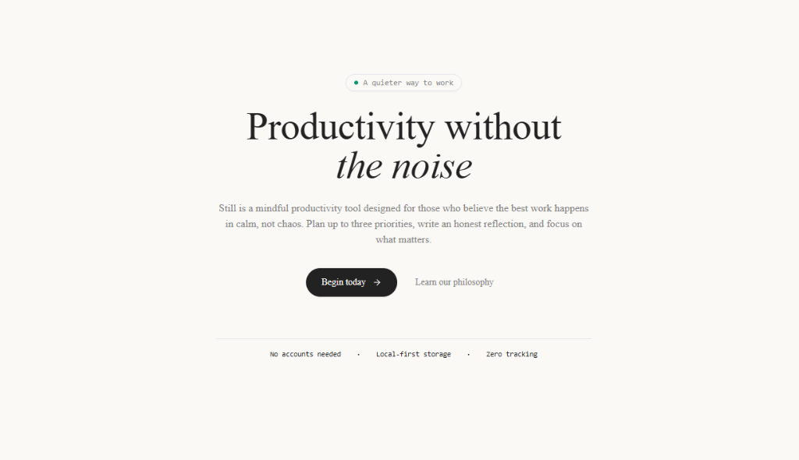

<div align="center">
  

  <br /><br />

  <h1>Still</h1>
  <p><strong>Productivity without the noise.</strong></p>
  <p>A quiet, minimalist daily planner designed for those who believe the best work happens in calm, not chaos.</p>

  <p>
    <a href="#philosophy">Philosophy</a> •
    <a href="#features">Features</a> •
    <a href="#tech-stack">Tech Stack</a> •
    <a href="#getting-started">Getting Started</a> •
    <a href="#license">License</a>
  </p>
</div>

---

## Philosophy

Most productivity tools create anxiety with endless backlogs, gamified streaks, and visual noise. **Still** takes the opposite path:

1. **Three Priorities Only**: An intentional constraint to focus on what actually moves your day forward.
2. **Distraction-Free Focus**: When you work, the interface recedes completely—leaving only a quiet timer and your chosen task.
3. **Local & Sovereign**: All notes, sessions, and daily entries remain in your browser's IndexedDB. No accounts, no cloud sync, zero telemetry.

---

## Features

- **Daily Rule of Three**: Plan up to 3 prioritized outcomes each day.
- **Evening Reflection Journal**: A private daily journal with debounced autosave.
- **Drift-Proof Focus Timer**: Wall-clock timestamp math that never drifts when tabs are hidden or inactive.
- **Dot-Matrix Calendar & Archive**: Chronological review of past days with an editorial dot-matrix monthly calendar view.
- **Restrained Aesthetics**: Warm-paper palette (`#FAF9F6`), editorial serif typography, and subtle dark mode (`#191816`).
- **Data Portability**: One-click JSON backup export and validated restore anytime.
- **Offline PWA**: Full Progressive Web App manifest and service worker caching for offline use.

---

## Tech Stack

- **Framework**: [Next.js 15](https://nextjs.org/) (Static HTML Export)
- **Library**: [React 19](https://react.dev/)
- **Language**: [TypeScript](https://www.typescriptlang.org/) (Strict mode)
- **Styling**: [Tailwind CSS](https://tailwindcss.com/)
- **Persistence**: Browser-native IndexedDB (`still_db`)
- **Icons**: [Lucide React](https://lucide.dev/)

---

## Getting Started

### Prerequisites

- Node.js 18.17+ or later
- npm, pnpm, or yarn

### Installation

```bash
# Clone the repository
git clone https://github.com/Arthurs-excalibur/Still.git

# Navigate into directory
cd Still

# Install dependencies
npm install

# Start development server
npm run dev
```

Open [http://localhost:3000](http://localhost:3000) in your browser.

### Scripts

- `npm run dev`: Start local development server
- `npm run build`: Build optimized static site into `out/`
- `npm run typecheck`: Run TypeScript type verification
- `npm test`: Run domain logic, timer engine, and schema assertions

---

## License

This project is licensed under the [Apache License 2.0](LICENSE).
